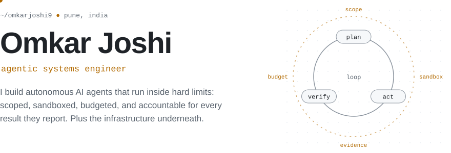
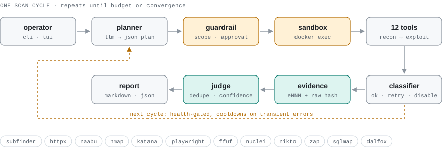
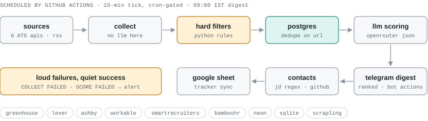
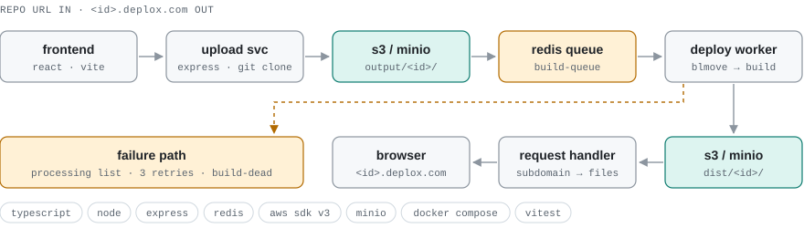
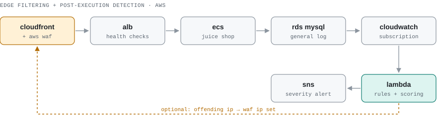

<picture>
  <source media="(prefers-color-scheme: dark)" srcset="assets/hero-dark.svg">
  
</picture>

  <a href="https://omkarnjoshi.vercel.app"><b>Portfolio</b></a> &nbsp;·&nbsp;
  <a href="https://www.linkedin.com/in/omkarjoshi9/"><b>LinkedIn</b></a> &nbsp;·&nbsp;
  <a href="https://leetcode.com/u/omkarjoshi2005/"><b>LeetCode</b></a> &nbsp;·&nbsp;
  <a href="mailto:omkarnjoshi9@gmail.com"><b>omkarnjoshi9@gmail.com</b></a>

Autonomy is easy to demo and hard to trust. Most of my work is the second part: deciding what an agent is **allowed** to do, where its code **runs**, how it **fails**, and what **proof** it leaves behind. I like systems where the LLM makes suggestions and ordinary, testable code makes the decisions.

 

## How I build

<table>
<tr>
<td width="50%" valign="top">

**Bound the agent** 
Scope allowlists, request and endpoint budgets, a cap on how many sub-agents it can spawn, and a human approval step before anything destructive.

</td>
<td width="50%" valign="top">

**Isolate execution** 
Tools run in a per-scan Docker sandbox from allowlisted argv, not shell strings. Untrusted builds get a stripped environment and a hard timeout.

</td>
</tr>
<tr>
<td width="50%" valign="top">

**Make failure a state** 
Tools move between healthy, degraded and disabled with cooldowns. Queues have an in-flight list, bounded retries and a dead-letter list.

</td>
<td width="50%" valign="top">

**Keep receipts** 
Every tool run gets an evidence ID and a raw-output hash. Pipelines dedupe on normalized keys and fail loudly when something breaks.

</td>
</tr>
</table>

 

## Featured systems

### 01 &nbsp;[Agentic Pentester](https://github.com/omkarjoshi9/agentic_pentester)
**An autonomous, multi-agent web pentesting loop that runs inside guardrails.**

<picture>
  <source media="(prefers-color-scheme: dark)" srcset="assets/arch-pentester-dark.svg">
  
</picture>

**The problem:** Scanners follow a fixed script. An LLM-driven tester adapts, but an unconstrained agent with `sqlmap` is a liability. 
**What I built:** A terminal-first orchestrator in plain Python, with no agent framework. An LLM planner reads the attack-surface state each cycle and proposes the next actions as schema-validated JSON. Twelve recon, discovery, scanning and exploitation tools then run in an isolated container, and a judge and summarizer turn the findings into Markdown and JSON reports.

- **Guardrail layer:** in-scope domain enforcement, endpoint and parameter limits, and explicit approval before exploit actions.
- **Sandboxed execution:** a Docker container per scan. Tools are resolved from an allowlist to fixed argv prefixes and run with `docker exec`.
- **Tool health policy:** permanent errors disable a tool, transient errors put it on a cooldown, and runs that find nothing build a "no-value" streak. This keeps the planner from looping on broken tools.
- **Bounded sub-agents:** collaborative and competitive modes. Spawn requests are capped at 3 children per batch, with at most one exploit child.
- **Chain of custody:** sequential `eNNN` evidence records with raw-output hashes, kept separately for each scan.
- **Tested like a security boundary:** escape tests cover scope bypass, rejection of unregistered tools and premature finish. CI runs pytest and ruff.

<code>Python</code> · <code>Docker</code> · <code>Gemini JSON mode</code> · <code>Pydantic</code> · <code>Playwright</code> · <code>OWASP ZAP</code> · <code>nuclei</code> · <code>GitHub Actions</code>

 

### 02 &nbsp;[jobdigest](https://github.com/omkarjoshi9/job_hunt)
**A scheduled data pipeline that turns a scattered job market into one ranked morning message.**

<picture>
  <source media="(prefers-color-scheme: dark)" srcset="assets/arch-jobdigest-dark.svg">
  
</picture>

**The problem:** Intern and new-grad roles in India are spread across company ATS boards, RSS feeds and portals, and each source uses a different format. 
**What I built:** A pipeline that runs on GitHub Actions. It pulls from six ATS APIs (Greenhouse, Lever, Ashby, Workable, SmartRecruiters, BambooHR) plus RSS and HTML portals, filters and scores the jobs, and sends a Telegram digest at 09:00 IST. A long-polling bot handles save, applied, hide and "why me?" actions.

- **LLM only where it adds value:** collection and hard filtering are deterministic Python. The model only scores jobs that passed the filters, and if summarization fails the digest falls back to plain bullet points.
- **Stateless runners, stateful system:** Actions runners keep no disk, so state lives in Neon Postgres. SQLite has the same schema and is used for local runs and tests.
- **Identity and dedupe:** apply URLs are normalized (UTM and click IDs stripped), so the same posting from an ATS and a portal is stored once. Stale listings are tombstoned after repeated misses.
- **Polite by design:** honors robots.txt, delays requests per host, keeps a kill-list for sites that shouldn't be scraped, and never auto-applies.
- **Operability:** a cron gate on a 15-minute tick, `COLLECT FAILED` / `SCORE FAILED` alerts, and silence when there is nothing new. The offline test suite has 50+ modules with mocked HTTP, LLM, Telegram and Sheets.

<code>Python</code> · <code>httpx</code> · <code>Scrapling / Playwright</code> · <code>PostgreSQL (Neon)</code> · <code>SQLite</code> · <code>OpenRouter</code> · <code>Telegram Bot API</code> · <code>Google Sheets API</code> · <code>GitHub Actions</code>

 

### 03 &nbsp;[DeploX](https://github.com/omkarjoshi9/DeploX)
**A small Vercel-style deployment platform: paste a repo URL, get a live subdomain.**

<picture>
  <source media="(prefers-color-scheme: dark)" srcset="assets/arch-deplox-dark.svg">
  
</picture>

**What I built:** Three TypeScript services and a React frontend. The upload service clones the repo, stores the source in S3-compatible storage and queues a build. A worker builds the project and uploads `dist/`. A request handler maps `<id>.deplox.com` to the right files.

- **Reliable queue:** jobs move atomically from `build-queue` to `build-processing` with `BLMOVE`. On startup the worker re-queues anything a crashed run left in flight. Failures retry 3 times and then go to `build-dead`, with the error saved.
- **Untrusted code awareness:** builds run with AWS and Redis credentials removed from the environment and a process-tree-killing timeout. The [sandboxing notes](https://github.com/omkarjoshi9/DeploX/blob/main/DeploX-Deploy-Service/SANDBOX.md) describe the production setup: dropped capabilities, a read-only root filesystem, pid and memory limits, and blocked metadata endpoints.
- **Strict ID contract:** `[a-z0-9]{10}` is validated before the ID is used as an S3 prefix or a subdomain.

<code>TypeScript</code> · <code>Node.js</code> · <code>Express</code> · <code>Redis</code> · <code>AWS SDK v3 / MinIO</code> · <code>React + Vite</code> · <code>Docker Compose</code>

 

### 04 &nbsp;[SQLi Detection Pipeline](https://github.com/omkarjoshi9/SQLi-prevention-pipeline)
**Defense in depth on AWS: block at the edge, then inspect what actually reached the database.**

<picture>
  <source media="(prefers-color-scheme: dark)" srcset="assets/arch-sqli-dark.svg">
  
</picture>

A WAF only sees requests, not the SQL that runs. This pipeline streams RDS query logs through CloudWatch into a Lambda function. The function blends rule matches (`UNION`, tautologies, comment injection, `information_schema` access) with a weighted token-heuristic score, publishes severity-ranked alerts to SNS, and can add the source IP to a WAF IP set. It was tested against a deployed OWASP Juice Shop.

<code>AWS CloudFront</code> · <code>WAF</code> · <code>ALB</code> · <code>ECS</code> · <code>RDS MySQL</code> · <code>CloudWatch</code> · <code>Lambda (Python)</code> · <code>SNS</code>

 

## More experiments

| Project | What it is | Built with |
|:--|:--|:--|
| [**Agentic Search**](https://github.com/omkarjoshi9/Agentic_Search) | Planner, selector, reporter, reviewer and router agents that search, scrape and write cited answers, looping until a reviewer accepts the report. | LangGraph · Groq · Serper · Streamlit |
| [**Repo Intelligence Bot**](https://github.com/omkarjoshi9/GitHub-Repo-Intelligence-Bot) | Polls your GitHub repos, summarizes new commits and PRs with an LLM and posts the summaries to Slack. | LangGraph · GitHub REST · OpenAI |
| [**Windows AI Foundry RAG**](https://github.com/omkarjoshi9/PSL_AI_Foundry) | Work from a research internship at PSL AI Foundry: an on-device RAG app with query rewriting, HyDE and reranking over Pinecone, plus a write-up comparing local model runtimes. | Python · Foundry Local · Pinecone |
| [**Age of Umpires**](https://ageofumpires.vercel.app) | A daily browser game: guess a cricket umpire's age from their portrait. | TypeScript · Vercel |

 

## Toolbox

<table>
<tr><td width="28%"><b>Agents &amp; LLMs</b></td><td>Custom orchestration loops, LangGraph, structured JSON outputs, RAG (HyDE, query rewriting, reranking), Gemini · OpenAI · Groq · OpenRouter</td></tr>
<tr><td><b>Backend &amp; data</b></td><td>Python, TypeScript / Node.js, Express, Redis queues, PostgreSQL, SQLite, REST APIs, scraping with Playwright</td></tr>
<tr><td><b>Cloud &amp; infra</b></td><td>Docker, Docker Compose, GitHub Actions (CI and scheduled pipelines), AWS (S3, Lambda, ECS, RDS, CloudFront, WAF, CloudWatch, SNS)</td></tr>
<tr><td><b>Security</b></td><td>OWASP ZAP, nuclei, sqlmap, ffuf, nmap, httpx, subfinder, katana, dalfox, nikto</td></tr>
<tr><td><b>Fundamentals</b></td><td>C++ for data structures and algorithms (<a href="https://leetcode.com/u/omkarjoshi2005/">187+ problems on LeetCode</a>), SQL</td></tr>
</table>

 

## Open source

I contribute to agent tooling that I actually use, mostly by improving documentation where I got stuck.

<!-- OSS:START -->
- **[MathiasPaulenko/wavexis-mcp](https://github.com/MathiasPaulenko/wavexis-mcp/pull/26)**: docs: add visual regression testing examples
- **[MathiasPaulenko/wavexis-mcp](https://github.com/MathiasPaulenko/wavexis-mcp/pull/25)**: docs: add Simplified Chinese and Japanese README translations
- **[skundu42/opendevops](https://github.com/skundu42/opendevops/pull/6)**: docs: expand CLI reference with grant flow and chat flags
- **[rxdt/loopgate_harness](https://github.com/rxdt/loopgate_harness/pull/28)**: docs: troubleshoot missing/unauthenticated worker CLI
<!-- OSS:END -->

 

## Recently shipped

<!-- RECENT:START -->
- **[SQLi-prevention-pipeline](https://github.com/omkarjoshi9/SQLi-prevention-pipeline)**: SQL injection detection pipeline on AWS (WAF + Lambda + SNS) · Nov 2026
- **[mcportfolio](https://github.com/omkarjoshi9/mcportfolio)**: Portfolio site built as a blocky sandbox world · Nov 2026
- **[agentic_pentester](https://github.com/omkarjoshi9/agentic_pentester)**: Autonomous multi-agent web pentesting loop with guardrails and a Docker sandbox · Oct 2026
- **[DeploX](https://github.com/omkarjoshi9/DeploX)**: Vercel-style deploy platform with a Redis build queue · Oct 2026
<!-- RECENT:END -->

The two lists above are refreshed daily by a GitHub Action in this repo.

 

---

Based in Pune, India. Away from the terminal I'm usually behind a camera, and some of that work is on my <a href="https://omkarnjoshi.vercel.app/photography">portfolio</a>. Open to conversations about agentic AI engineering, infrastructure and security work.
