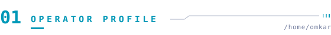
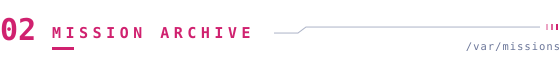
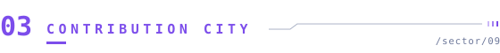
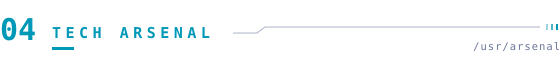
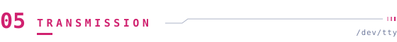
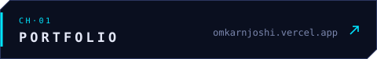
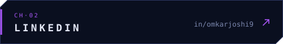
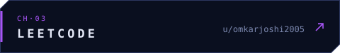

 

**Autonomy is easy to demo and hard to trust.** Most of my work is the second part: deciding what an agent is *allowed* to do, where its code *runs*, how it *fails*, and what *proof* it leaves behind. I like systems where the LLM makes suggestions and ordinary, testable code makes the decisions.

I work across agentic AI and LLM systems, the backends and cloud infrastructure they run on, and the security of both. I did a research internship at PSL AI Foundry on on-device RAG.

<table>
<tr>
<td><code>P&#8209;01</code></td>
<td><b>Bound the agent</b></td>
<td>Scope allowlists, request and endpoint budgets, a cap on sub-agents, and a human approval step before anything destructive.</td>
</tr>
<tr>
<td><code>P&#8209;02</code></td>
<td><b>Isolate execution</b></td>
<td>Tools run in a per-scan Docker sandbox from allowlisted argv, never shell strings. Untrusted builds get a stripped environment and a hard timeout.</td>
</tr>
<tr>
<td><code>P&#8209;03</code></td>
<td><b>Make failure a state</b></td>
<td>Tools move between healthy, degraded and disabled. Queues have an in-flight list, bounded retries and a dead-letter list.</td>
</tr>
<tr>
<td><code>P&#8209;04</code></td>
<td><b>Keep receipts</b></td>
<td>Every tool run gets an evidence ID and a raw-output hash. Pipelines dedupe on normalized keys and fail loudly.</td>
</tr>
</table>

 

<table>
<tr>
<td width="50%" valign="top">
<code>M&#8209;01</code> &nbsp;<a href="https://github.com/omkarjoshi9/agentic_pentester"><b>Agentic Pentester</b></a> &nbsp;AI SECURITY 
Autonomous multi-agent web pentesting. An LLM planner proposes actions as validated JSON; plain Python enforces scope, budgets and approval, and runs 12 tools in a per-scan Docker sandbox with hashed evidence. 
Python · Docker · Gemini · Pydantic · ZAP · nuclei
</td>
<td width="50%" valign="top">
<code>M&#8209;02</code> &nbsp;<a href="https://github.com/omkarjoshi9/job_hunt"><b>jobdigest</b></a> &nbsp;DATA PIPELINE 
Scheduled pipeline that pulls jobs from six ATS APIs and portals, filters and dedupes them deterministically, lets an LLM score only what's left, and sends a ranked Telegram digest at 09:00 IST. 
Python · Postgres (Neon) · OpenRouter · Telegram · Actions
</td>
</tr>
<tr>
<td width="50%" valign="top">
<code>M&#8209;03</code> &nbsp;<a href="https://github.com/omkarjoshi9/DeploX"><b>DeploX</b></a> &nbsp;PLATFORM 
Vercel-style deploys: paste a repo URL, get a live subdomain. A Redis queue with atomic in-flight moves, retries and a dead-letter list; builds run without credentials under a hard timeout. 
TypeScript · Express · Redis · S3 / MinIO · React
</td>
<td width="50%" valign="top">
<code>M&#8209;04</code> &nbsp;<a href="https://github.com/omkarjoshi9/SQLi-prevention-pipeline"><b>SQLi Detection</b></a> &nbsp;CLOUD SECURITY 
Blocks at the edge with WAF, then inspects the SQL that actually ran: RDS logs stream to a Lambda detector that alerts via SNS and can block the source IP. 
CloudFront · WAF · ECS · RDS · Lambda · SNS
</td>
</tr>
</table>

<b>SIDE CHANNELS</b> &nbsp;/&nbsp;
<a href="https://github.com/omkarjoshi9/Agentic_Search">Agentic Search</a>: multi-agent research with a reviewer loop &nbsp;·&nbsp;
<a href="https://github.com/omkarjoshi9/GitHub-Repo-Intelligence-Bot">Repo Intelligence Bot</a>: LLM commit and PR digests to Slack &nbsp;·&nbsp;
<a href="https://github.com/omkarjoshi9/PSL_AI_Foundry">Windows AI Foundry RAG</a>: on-device RAG, internship work &nbsp;·&nbsp;
<a href="https://github.com/omkarjoshi9/agentguard">AgentGuard</a>: least-privilege agent permissions, design stage &nbsp;·&nbsp;
<a href="https://ageofumpires.vercel.app">Age of Umpires</a>: a daily cricket guessing game

 

Rebuilt every day from GitHub's contribution calendar by <a href="scripts/build_city.py"><code>scripts/build_city.py</code></a>. One block per day, oldest week in the far corner. Height grows with √contributions; window light follows GitHub's own quartile levels.

<table>
<tr>
<td width="50%" valign="top">

<b>RECENTLY SHIPPED</b>

<!-- RECENT:START -->
- **[DeploX](https://github.com/omkarjoshi9/DeploX)**: Vercel-style deploy platform with a Redis build queue · Nov 2026
- **[job_hunt](https://github.com/omkarjoshi9/job_hunt)**: Scheduled job-digest pipeline delivering a ranked Telegram digest · Nov 2026
- **[SQLi-prevention-pipeline](https://github.com/omkarjoshi9/SQLi-prevention-pipeline)**: SQL injection detection pipeline on AWS (WAF + Lambda + SNS) · Nov 2026
- **[mcportfolio](https://github.com/omkarjoshi9/mcportfolio)**: Portfolio site built as a blocky sandbox world · Nov 2026
<!-- RECENT:END -->

</td>
<td width="50%" valign="top">

<b>MERGED UPSTREAM</b>

<!-- OSS:START -->
- **[MathiasPaulenko/wavexis-mcp](https://github.com/MathiasPaulenko/wavexis-mcp/pull/26)**: docs: add visual regression testing examples
- **[MathiasPaulenko/wavexis-mcp](https://github.com/MathiasPaulenko/wavexis-mcp/pull/25)**: docs: add Simplified Chinese and Japanese README translations
- **[skundu42/opendevops](https://github.com/skundu42/opendevops/pull/6)**: docs: expand CLI reference with grant flow and chat flags
- **[rxdt/loopgate_harness](https://github.com/rxdt/loopgate_harness/pull/28)**: docs: troubleshoot missing/unauthenticated worker CLI
- **[norqen-ai/norqen-frontend](https://github.com/norqen-ai/norqen-frontend/pull/1)**: Initial Norqen frontend build
<!-- OSS:END -->

</td>
</tr>
</table>

 

 

Open to conversations about agentic AI engineering, infrastructure and security work. Away from the terminal I'm usually behind a camera; some of that work is on my <a href="https://omkarnjoshi.vercel.app/photography">portfolio</a>.
